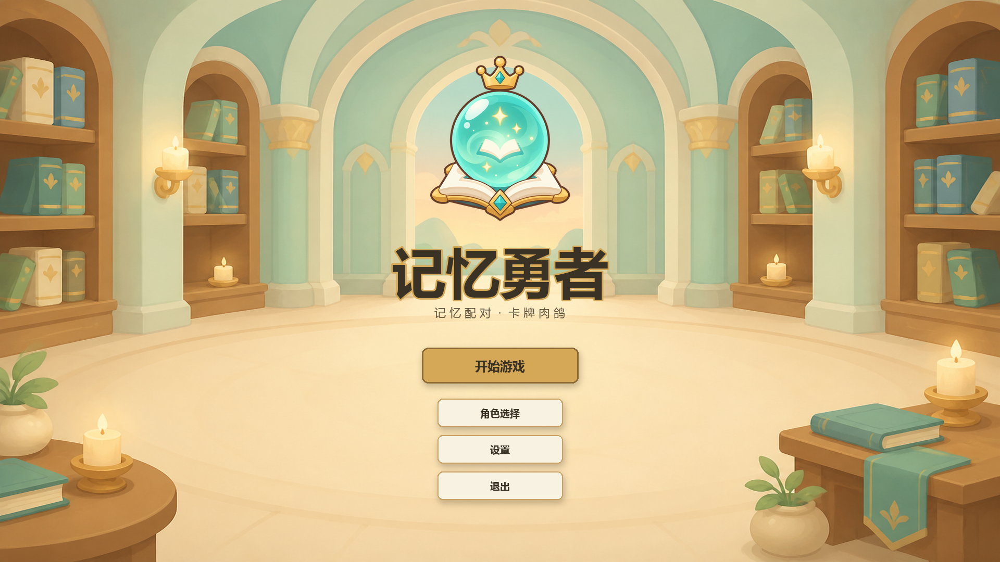
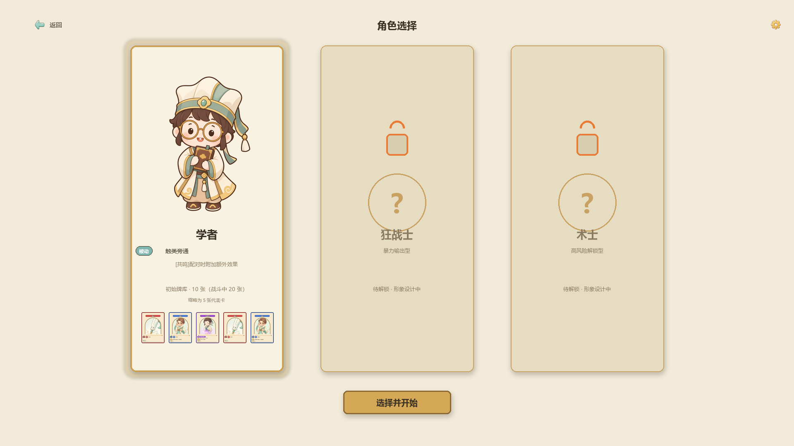
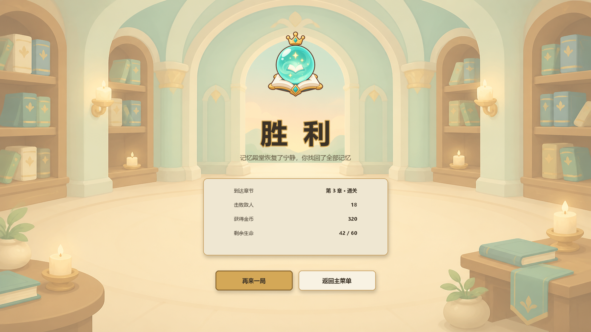
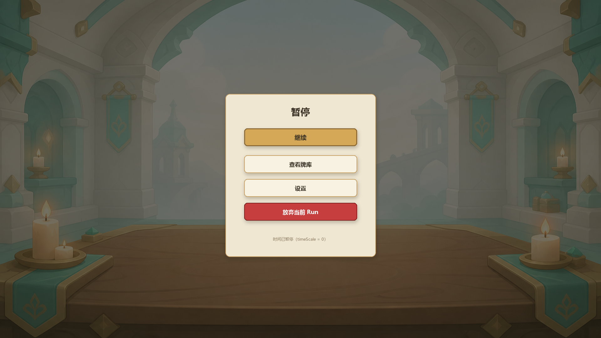
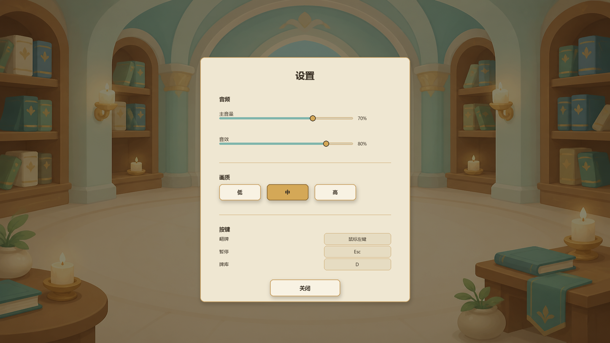

# UI 交互与流程规范

> **本文为《UI 设计规范》拆分后的功能/行为正本**（2026-11-18 按仓库边界合同 §4.1 拆分）。界面导航、交互行为、特殊 UI 状态语义、动画触发时序与游戏事件顺序以本文为准；视觉风格、布局几何、排版、素材与插画规格正本在 Memory-Art《[09-UI视觉规范与布局](https://github.com/cnoom/Memory-Art/blob/main/docs/design/09-UI视觉规范与布局.md)》。
> 拆分自本仓 `docs/design/09-UI设计规范.md`（master@c34f2f8，版本 1.22）；拆分时全文快照在 Memory-Art `docs/design/source-snapshots/2026-11-18-09-UI设计规范-原全文.md`。原章节号保留。

> **V7.2卡牌详情规范覆盖（2026-11-17，待Unity迁移）**：所有卡面专有名词（含格挡、护甲、力量、流血、触发关键词与临时等）须使用统一词典提供点击/聚焦说明；详情页为可复用独立组件，点击非交互区域关闭、点击词汇只展开解释、不穿透棋盘。优先级以 [25·V7.2防御机制与卡牌详情关键词规范](./25-V7.2防御机制与卡牌详情关键词规范.md) 为准；本文旧悬停2秒/贴身预览等交互仍为历史或当前实现对照。

> **卡牌重设计基线（首批已接入 2026-11-09）**：重设计版本移除揭示覆层，抽牌堆只显示数量，共鸣失败提示仅在实际翻牌后出现——三项表现均已入 Unity。 详见 [15·战斗信息与学者卡牌重设计](./15-战斗信息与学者卡牌重设计.md)。下文相关旧规则用于对照当前实现或历史内容。

> **2026-11-06 工程状态**：本文件部分「待实现」及旧视觉规则是原设计阶段的历史标记，不表示当前 Unity UI 未实现。现行 UI 以最新 V05/B03 覆盖条款和游戏仓的预制体、面板代码、013/014/031/032 交付记录共同校验；不得按旧版恢复糖果按钮或青金旧框。

> **2026-10-31 行动条两项裁定（用户）**：①每次 +1 恒亮一格——**临界预警态退役**（距行动 1 点时末段不再瞬时变红——旧实现与前段渐显同拍，观感=「快满时一次跳两段」；预警由「距行动 N 点」文本承载）；②**涨满=末段红白交替闪光**（300ms，两拍+轻微放大，复用 hud_action_critical 素材为红相）→敌人攻击动画→攻击完成段位逐个熄灭（满格态贯穿攻击全程，熄灭节拍不变、时点后移至攻击完成）。覆盖 §4.3 旧「阈值标记」行与 §10.2 旧四步序列。

> **2026-10-14 设置范围调整（用户裁决）**：设置页只保留主音量、音乐、音效，以及恢复默认、完成和关闭；取消画质与右侧操作说明。此条覆盖下文旧S13画质/按键展示口径。修订示意见ImageReview/batches/settings-j02，尚未发布。

---

## 目录

5. [界面清单与导航流程](#5-界面清单与导航流程)
6.7. [卡牌详情预览（交互）](#67-卡牌详情预览悬停驻留查看)
6.8. [战斗中的特殊UI状态](#68-战斗中的特殊ui状态)
9. [交互模式](#9-交互模式)
10.2. [行动条满→敌人行动时序](#102-关键动画)

> 视觉/布局/组件/色彩/字体/动画视觉表现正本：Memory-Art《09-UI视觉规范与布局》。

---

## 5. 界面清单与导航流程

### 5.1 界面清单

| 编号 | 界面 | 类型 | 说明 |
|---|---|---|---|
| S01 | 主菜单 | 全屏 | 开始游戏/角色选择/设置/退出 |
| S02 | 角色选择 | 全屏 | 选择角色，查看被动和初始牌库 |
| S03 | 战斗界面 | 全屏 | 核心战斗，4×4卡牌网格 |
| S04 | Meta地图 | 全屏 | 节点地图，路径选择 |
| S05 | 卡牌奖励 | 模态 | 战斗胜利后三选一 |
| S06 | 牌库查看 | 模态/全屏 | 查看当前牌库构成（run 级牌区，不受战斗影响）；计数为库内单份，战斗中每张×2（见 §8.2.1） |
| S07 | 商店 | 全屏 | 购买卡牌/遗物/移除卡牌 |
| S08 | 篝火 | 全屏 | 回血或升级卡牌 |
| S09 | 事件 | 全屏 | 随机事件，选择选项 |
| S10 | Boss遗物奖励 | 模态 | 三选一Boss遗物 |
| S11 | 胜利/失败 | 全屏 | Run结束结算 |
| S12 | 暂停菜单 | 模态 | 暂停/设置/退出 |
| S13 | 设置 | 模态 | 音量/画质/按键 |

**S01 主菜单示意图**（程序合成，`ui_mockup.py`；字标字体为雅黑近似，正式实现按 §3 用思源宋体；徽标=记忆宝珠+摊开书本+小金冠，与通用卡背徽记同家族）：



### 5.2 导航流程图

```
S01 主菜单
  ├─→ S02 角色选择
  │     └─→ S04 Meta地图（第1章）
  │           ├─→ S03 战斗界面
  │           │     ├─→ (胜利) S05 卡牌奖励 → S04
  │           │     ├─→ (Boss击杀) S10 Boss遗物奖励 → S04（下一章）
  │           │     └─→ (失败) S11 失败界面
  │           ├─→ S07 商店 → S04
  │           ├─→ S08 篝火 → S04
  │           ├─→ S09 事件 → S04
  │           └─→ S03 战斗界面（Boss节点）
  │                 └─→ S10 Boss遗物 → S04（下一章或胜利）
  ├─→ S13 设置
  └─→ 退出

  任意界面 ─→ S12 暂停菜单（模态）
  任意界面 ─→ S06 牌库查看（模态，战斗中/地图中均可）
```

### 5.3 Meta地图节点流程

每章地图**自下而上**推进：底部为起点，顶部为章节 Boss；章节间从左到右衔接，第三章 Boss 战胜利后进入胜利界面。

> **028 布局注记（2026-10-20）**：028 章层数扩容起每章内容层 4→**15**（结构正本=05§1 v1.44，节点 62/17 行），下图为 4 层期旧观示意（布局概念仍准——行=层、4 列等距、起点/Boss 居中）；实现侧行距随层数动态均分、一屏完整呈现。

```
章节1                    章节2                    章节3
┌──────────────┐        ┌──────────────┐        ┌──────────────┐
│     Boss     │        │     Boss     │        │     Boss     │ ─→ S11 胜利界面
│      │       │        │      │       │        │      │       │
│  事─战─篝─战 │        │  战─篝─战─事 │        │  篝─战─事─战 │
│   │  │  │  │ │        │   │  │  │  │ │        │   │  │  │  │ │
│  战─商─战─战 │   →    │  战─事─战─战 │   →    │  事─战─战─战 │
│   │  │  │  │ │        │   │  │  │  │ │        │   │  │  │  │ │
│  战─战─事─精 │        │  事─战─商─精 │        │  战─事─精─商 │
│      │       │        │      │       │        │      │       │
│     起点     │        │     起点     │        │     起点     │
└──────────────┘        └──────────────┘        └──────────────┘
```

### 5.4 其他界面示意图（S02/S11/S12/S13）

v1.5 起补齐；均为程序合成示意图（`ui_mockup.py`，规格见对应小节或下方说明）。

**S02 角色选择**（三列并列：学者可选·狂战士/术士待解锁形象设计，见 [05·角色系统]）：



**S11 胜利结算**（Run 结束统计 + 再来一局/返回主菜单；失败界面同构，标题与统计项换失败口径）：

> **统计项口径（v1.19，2026-09-26 实现侧澄清，用户裁决）**：统计区固定四项——**到达章节**（胜利=「第 1 章 · 通关」；失败=「第 1 章 · 败于 XX 节点」，XX 为失败节点类型）/ **击败敌人 N**（run 累计击杀）/ **获得金币 N**（run 累计获得，非持有余额）/ **剩余生命 x / y**（结算时血量；失败恒 0）。失败界面同构换口径（标题「失败」、四项按失败时数据）。



**S12 暂停菜单**（模态，规格见 §9.4）：



**S13 设置**（模态：音量/画质/按键）：



---

### 6.7 卡牌详情预览（悬停驻留查看）

**正面朝上的卡牌悬停静止 2 秒**时，展示放大预览（现行形态=右栏详情，11§12）：

```
                    ┌─────────────────────┐
                    │ 火球术         ⚔ 普通 │
                    │ ─────────────────── │
                    │                     │
                    │   造成 6 点伤害      │
                    │                     │
                    │ ─────────────────── │
                    │ [共鸣]              │
                    └─────────────────────┘
```

预览卡尺寸：240 × 320 px，**点击后立即于点击位置弹出**——面板中心对准点击瞬间的鼠标/触点位置（弹出后不跟随移动），画布边缘自动钳制（面板完整可见，不超出屏幕），不单独划分预览区域。关闭路径：点击预览面板、鼠标移出预览面板、再次点击同一张正面牌（同卡开关）；点击背面牌发起翻牌时若预览仍开着则一并收起。点击背面牌不弹出任何牌面信息（保持背面，情报不泄露）。被封锁的正面牌，详情面板底部显示封锁说明行：「⛔ 被封锁：无法参与配对，敌人下次行动后解除」（v1.17，§6.8.5）。

> 2026-10-27（v1.21）：触发由「点击查看」（v1.16）改为「**悬停驻留 2 秒**」——指针在正面牌上静止满 2s 才弹出；扫过、翻牌点击等非查看意图不触发。v1.16 弃悬停的「扫过误触」顾虑由 2s 驻留门槛化解。关闭路径：点击正被展示的卡（显式收起）、点击背面牌发起翻牌时一并收起（既有）、战斗终局收起；**指针移出卡面不收起**（11§4.4：指针须能从卡面移入详情阅读，关闭不得闪退）。点击正面牌不再打开详情。
> 2026-09-13（v1.16）：触发由「悬停 200ms」（09 v1.15 口径）改为「点击查看」——悬停易误触（扫过牌面即弹出，干扰翻牌操作），点击是明确的查看意图；仅**正面朝上**的卡牌可点击查看，背面牌点击仍为翻牌。关闭路径随触发方式调整为：点击面板/移出面板/再点同卡；200ms 延迟随悬停机制一并废除。
> 2026-09-12（v1.15）：定位由「贴身弹出——紧邻被悬停卡（约 20px 间隙）并跟随鼠标」（09 v1.6 布局重构口径）改为「鼠标位置弹出、不跟随」——跟随鼠标的持续移动干扰阅读，固定位置更利于对照卡面阅读完整词条；新增画布边缘钳制与关闭三径的显性口径。

### 6.8 战斗中的特殊UI状态

#### 6.8.1 揭示效果

```
┌─────────────────┐
│ ┌─────────────┐ │  ← 半透明蓝色遮罩
│ │  火球术      │ │  ← 卡面内容半透明显示
│ │  造成6伤害   │ │
│ │             │ │
│ └─────────────┘ │
│      3.0s       │  ← 倒计时进度条
│  ████████░░░░   │
└─────────────────┘
```

#### 6.8.2 标记效果

```
┌─────────────────┐   ┌─────────────────┐
│ ┌─────────────┐ │   │ ┌─────────────┐ │
│ │  (卡背)     │ │   │ │  打击       │ │ ← 翻开后：对应数值
│ │             │ │   │ │  6伤害 ✦+1 │ │   旁显示金色「✦+N」
│ │             │ │   │ │             │ │   加成标注（逐层）
│ └─────────────┘ │   │ └─────────────┘ │
│           ✦×2   │   │           ✦×2   │
└─────────────────┘   └─────────────────┘
      （背面）               （正面）
```

> v1.20 重设计：标记为增益机制——落点随机（优先有增益数值的牌，全无才纯随机），
> 每层随机一项基础效果数值临时+1，配对结算时生效。
> ~~背面角标只显示层数，不显示内容与具体增益项（情报不泄露，情报职能归揭示）~~；**〔2026-11-09 重设计覆盖〕背面完全不显示角标（层数/类别都不显示——避免间接提示效果类别），✶+N 聚合角标仅正面显示；机制数值照常**；
> 翻开为正面后，卡面在对应数值旁逐层显示加成标注。

#### 6.8.3 全局揭示（目录/图书馆）

所有背面牌同时显示半透明内容，屏幕边缘有蓝色光效脉动。全局揭示持续期间屏幕略微变暗以突出卡牌内容。

#### 6.8.4 换位/混乱动画

被交换的两张牌沿弧线路径移动到对方位置，移动时间 0.5s，移动过程中带有紫色拖尾光效。

#### 6.8.5 封锁效果（敌人封锁能力）

```
┌─────────────────┐
│ ┌─────────────┐ │  ← 半透明暗紫遮罩（整卡覆盖）
│ │  ⛔ 封锁    │ │  ← 居中封印符文章（正/背面均可见）
│ │             │ │
│ └─────────────┘ │
└─────────────────┘
```

> 静态视觉对齐 §4.4.5 封锁行：**暗紫色半透明遮罩覆盖整卡 + 居中封印符文**，正/背面均可见（封锁不区分朝向，玩家从任意朝向都应识别出"这张牌被封了"）。原型阶段符文以「⛔封锁」文字章呈现。
>
> **施加动效**（敌人行动序列内落格）：卡牌轻震（150ms）→ 暗紫遮罩淡入（200ms）→ 符文章盖印弹入（scale 0→1.15→1，200ms）。
> **解封动效**（敌人下次行动序列完成时统一解除，04§3）：遮罩淡出（200ms）+ 卡位飘字「封锁解除」。
> **匹配失败提示**：翻开的牌与桌面某正面牌本可配对（同名/[共鸣]/[剑]×[盾]）、仅因封锁被排除而未配对时，于**被封锁牌卡位**飘字「⛔ 被封锁，无法配对」——封锁对配对的影响必须被玩家感知，否则表现为"两张同名牌莫名没配上"的故障感。


## 9. 交互模式

### 9.1 翻牌交互

翻牌是核心操作，需要明确的视觉反馈链：

```
鼠标悬停背面牌
  → 卡牌微上浮 4px + 边框发光（200ms延迟）
  
点击卡牌
  → 翻转动画（0.3s，3D旋转Y轴）
  → 卡面展示
  → [翻开]效果结算（如有）
  → 匹配判定
    → 匹配成功：两张牌发光 → 淡出消除（0.4s） → 粒子效果
    → 匹配失败：保持正面（等待下次翻牌）
  → 行动条 +1 动画
  
之前的正面牌
  → 翻回背面动画（0.3s）
```

### 9.2 卡牌详情预览交互

| 对象 | 触发 | 展示 |
|---|---|---|
| 正面朝上的卡牌 | 悬停 2s（v1.21，原点击） | 放大预览卡（右栏详情，11§12；再点同卡收起） |
| 背面朝上的卡牌 | 点击 | 无预览（翻牌；保持背面信息不泄露） |
| 标记的背面牌 | 悬停 200ms | 层数浮窗「标记×N」——不显示牌面内容与具体增益项 |
| 遗物图标 | 悬停 200ms | 遗物详情面板 |
| 状态效果图标 | 悬停 200ms | 状态说明tooltip |
| 敌人意图 | 悬停 200ms | 详细意图说明 |

> 2026-10-27（v1.21）：卡牌详情预览触发改为悬停驻留 2s（09 §6.7）；非卡牌对象（标记层数/遗物/状态/意图）保持悬停口径不变。
> 2026-09-13（v1.16）：卡牌详情预览触发改为点击（09 §6.7）；非卡牌对象（标记层数/遗物/状态/意图）保持悬停口径不变。

### 9.3 重新铺满交互

```
点击"重新铺满"按钮
  → 确认弹窗："重新铺满桌面？行动条 +2"
  → [确认] [取消]
  → 确认后：
    → 当前桌面所有牌淡出（0.3s）
    → 新牌从抽牌堆飞入网格（0.5s，依次铺入）
    → 行动条 +2 动画
```

### 9.4 暂停菜单

```
ESC / 点击菜单按钮
  → 游戏暂停（时间缩放=0）
  → 模态面板弹出：
    [继续]
    [查看牌库]
    [设置]
    [放弃当前Run]
```

---

## 10.2 关键动画——行动条满→敌人行动（2026-10-31 用户裁定，覆盖旧四步）

#### 行动条满→敌人行动（2026-10-31 用户裁定，覆盖旧四步）
1. 行动条涨满：末段随 +1 渐显点亮（每次 +1 恒亮一格——临界预警态退役，预警由「距行动 N 点」文本承载）
2. 满格末段红白交替闪光+轻微放大（300ms 两拍，红相复用 hud_action_critical 素材）
3. 敌人行动动画（攻击=立绘扑击，伤害绑冲撞段末命中时刻；蓄力/防御/特殊无扑击——闪光后行动条直接熄灭）
4. 攻击完成（扑击收势）后行动条重置（段位逐个熄灭，300ms——满格态贯穿攻击全程，熄灭节拍不变、时点后移）

