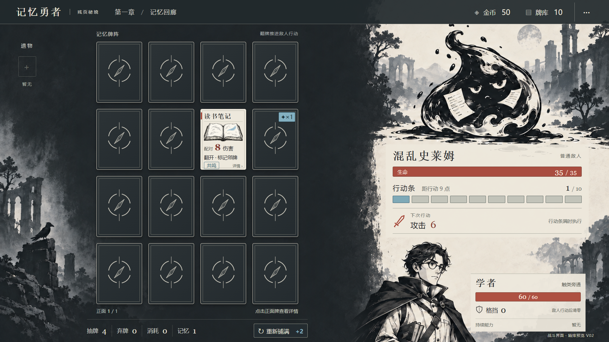
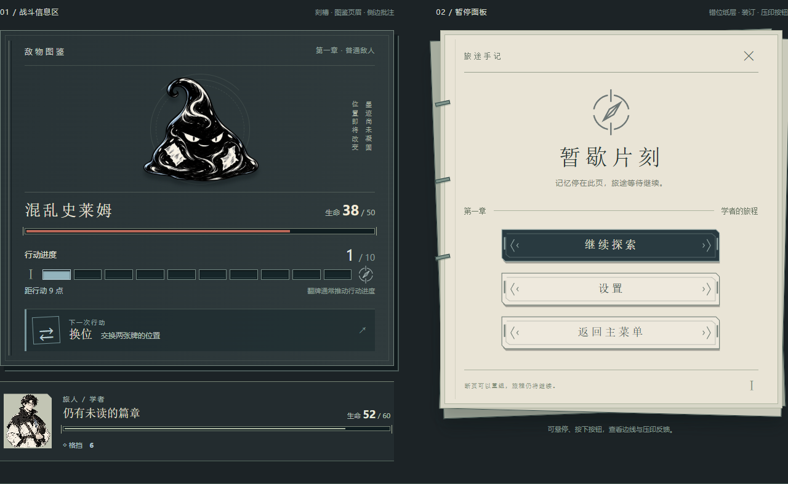
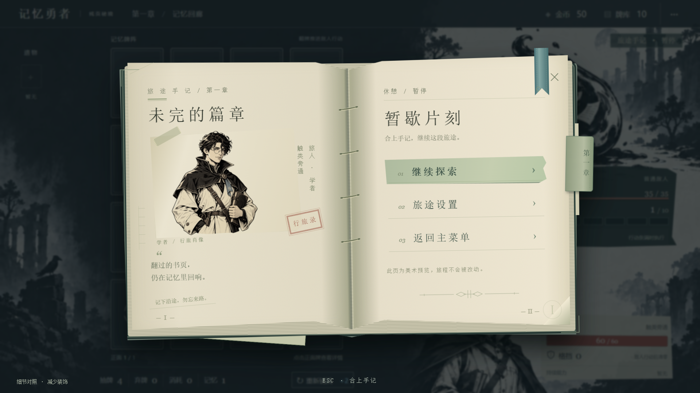
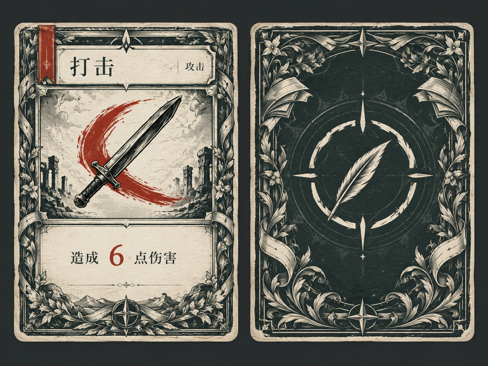

# 《记忆勇者》美术设计方案

> 日期：2026-09-25｜版本：v1.4｜状态：版画方向、战斗 V02、基础组件 B03 与手记细节 V05 已确认收录  
> 推荐主题：**残页秘境——蚀刻版画风的记忆探险**  
> 用途：后续 UI、卡牌、角色、敌人及场景生成的统一依据。

## 1. 推荐结论

**从零建立新的视觉体系。** 用户已明确不喜欢旧美术，并主动移除了全部旧图。旧图不恢复、不复用；青金书斋、宝珠徽记、拱窗卡框和糖果按钮也不作为新的设计约束。

推荐采用：**2D 蚀刻版画插画 + 现代清晰排版 + 少量专色**。

画面想象：一册被打散的探险图鉴，展开为可进入的秘境。牌面是记忆留下的印迹；玩家在炭灰桌面上翻开骨白纸牌，把零散记忆连成力量。敌人仿佛从书页边缘的墨影中走出来，朱红印记提示正在逼近的危险。

整体气质是神秘、机敏、带一点怪诞的冒险感。画面有强烈黑白形状，局部使用颜色，避免血腥恐怖、沉重压抑和满屏做旧。这个主题是视觉隐喻，不新增剧情或游戏系统。

选择它的原因：

- **适合记忆**：清楚的大轮廓，比一组相似的发光物件更容易区分。
- **突出翻牌**：深墨卡背与骨白正面形成直接反差，翻开本身就是视觉奖励。
- **突出决策**：有限的专色集中表达意图、状态和交互，便于判断翻牌代价。
- **便于扩展**：版画语言可以同时容纳学者、狂战士、术士与各种怪物，不把整款游戏绑定成书斋主题。
- **便于生产**：卡框与排版可统一生成，插画以主体和剪影区别，减少复杂装饰的一致性负担。

用户已认可首轮版画样张，并确认以此作为后续 UI 方向。玩法以 01—08 的系统和内容定义为依据；09、10 中的旧视觉条目以本方案的新方向为准逐项替换。方向确认不等同于后续所有新资产获得发布许可，资源命名、分层、预览与发布流程继续遵循仓库约定。

## 2. 从玩法推导视觉要求

| 游戏事实 | 美术必须解决的问题 |
|---|---|
| 4×4 位置记忆是核心 | 网格稳定、卡距一致，镜头和悬停不能扰乱位置 |
| 默认结算后最多一张正面牌 | 正面需要在短暂出现时容易识别；常态卡背必须耐看 |
| 同名配对，少量词条支持跨名匹配 | 区分具体卡牌；不能用同类型配色暗示同类型可互配 |
| 翻牌通常推动敌人行动条 | 行动条与意图是牌阵之外最重要的信息 |
| 标记是增益，不是情报 | 背面只显示层数，不显示身份或具体增益项 |
| 换位、污染、封锁干扰牌桌 | 每次干扰有清楚来源、路径和结果 |
| 卡牌词条没有数量上限 | 桌面卡负责识别，详情负责完整读规则 |
| 能力牌翻开后离场，持续生效 | 持续能力进入玩家信息区，不能为表现效果而留在牌阵 |

视觉优先级：**卡牌身份与位置 → 敌人行动条和意图 → 玩家生命与格挡 → 当前触发反馈 → 场景气氛。**

不自动标出曾经看过的隐藏牌，不增加隐藏牌位置记录。记忆堆按规则显示触发记录，不能变成牌桌定位器。无能量槽、结束回合按钮或主动遗物按钮。

## 3. 全新的视觉语言

### 3.1 造型与材质

**核心母题：断环、成对刻痕、错开的纸片。** 断环代表尚未重组的记忆，配对反馈时短暂闭合；只作为品牌与反馈符号，不暗示额外匹配规则。

- 纸：骨白棉纸，细微纤维感，阅读区域平整干净。
- 墨：炭黑墨块与少量排线，强调清楚轮廓。
- 环境：粗布、木刻纹理、石墙的大块阴影；不画华丽金属框。
- 线条：外轮廓较强，内部线条稀疏；主体保持两至三个主要明暗面。
- 光源：左上侧光，以留白塑造亮部、墨块塑造暗部，避免塑料光泽。
- UI 几何：微圆角直边矩形、短分隔线、小标签；插画可以手工起伏，文字和组件边界保持清楚。

**版画感主要来自轮廓、留白与墨块，不依赖密集细线。** 144px 宽小卡上的细排线会变成噪声，因此缩小版本需要主动简化。

### 3.2 建议色板

| 用途 | 色值 | 使用原则 |
|---|---|---|
| 场景墨黑 | `#202326` | 外围空间和远景暗部 |
| 牌桌炭灰 | `#343A3D` | 安静、均匀的网格底面 |
| 卡背深墨 | `#252B30` | 骨白细边使其与桌面分离 |
| 主阅读骨白 | `#EDE8DC` | 卡面、详情、事件正文 |
| 次级纸灰 | `#D1CBBD` | 分组底板和次级标签 |
| 主文字 | `#242629` | 浅底正文与标题 |
| 辅助文字 | `#5C5C56` | 浅底说明，避免过浅灰 |
| 雾蓝 | `#83B0C1` | 选中轮廓、操作反馈、标记底签 |
| 记忆白 | `#F4F0E7` | 配对印记与瞬时线条 |
| 朱红 | `#B94D3E` | 危险、受伤、行动临界 |
| 攻击 / 技能 / 能力 / 诅咒 | `#A44436` / `#396577` / `#705A80` / `#45414A` | 只用于类型小标和窄色条 |

战斗以炭灰与纸白建立层级，彩色面积控制在约一成以内。地图、奖励和休息界面增加纸白占比，形成节奏变化。朱红主要属于危险，普通确认按钮不使用红色。

类型同时用图形编码：攻击为剑、技能为卷轴、能力为菱形、诅咒为破损印记。配对词条另设符号，不能与类型图标混用。稀有度使用名称和底部小刻度，不再让整圈卡框承担两套颜色编码。

### 3.3 品牌与字形

Logo 建议为粗细有变化的中文字标「记忆勇者」，搭配断环中两枚相向刻痕。只在个别笔画设置轻微断口，保证中文可读；不加皇冠、宝珠或复杂盾徽。

标题与卡名可使用 Noto Serif SC Bold，正文使用 Noto Sans SC Regular；数字优先使用清楚的等宽数字特性。字体选择依据中文阅读需要，不以复用旧风格为目的。

1920×1080 显示字号建议：大标题 36—44px，分组标题 26—30px，规则正文 22—24px，小卡名称 20—22px，辅助标签 18—20px，关键数值 30—36px。不用 Light 字重承载小字，不把源图文字按比例缩成微字。

## 4. 战斗界面：首先验证的页面

### 4.1 画面构成

左侧偏中是规则的 4×4 牌阵，深墨卡背中只有少量正面纸白。右侧敌人以版画剪影和局部专色呈现，站在横向地面笔触上；其下依次为血量、行动条和意图，最下方为玩家信息。

场景边缘可露出低对比残墙、阶梯、树影或远处建筑；卡牌下面完全留净。实际网格正视、等大、等距，不受背景透视影响。牌阵不用金框或拱门包围。

采用左右分区，是为竖卡 4×4 争取高度的布局选择。保持功能关系不意味着沿用旧装饰。

### 4.2 1920×1080 布局建议

| 区域 | 位置与尺寸 | 内容 |
|---|---|---|
| 顶栏 | x=48，y=24，w=1824，h=56 | 菜单、章节、金币、牌库、设置 |
| 遗物栏 | x=48，y=120，w=88，h=832 | 48px 图标，必要时滚动 |
| 牌桌范围 | x=180，y=108，w=924，h=916 | 安静底面、细边界 |
| 4×4 网格 | x=324，y=132，w=636，h=828 | 单卡 144×192；横纵间距均 20px |
| 牌桌托盘 | x=240，y=980，w=804，h=44 | 抽牌、弃牌、消耗、记忆四堆；重新铺满 |
| 敌人展示 | x=1180，y=116，w=604，h=424 | 敌人立绘和短地面笔触 |
| 敌人信息 | x=1160，y=560，w=660，h=254 | 名称、生命、行动条、意图、状态 |
| 玩家信息 | x=1160，y=844，w=660，h=180 | 头像、生命、格挡、状态、持续能力 |

这是起始排版，不是已验证的成品尺寸。正式 UI 用真实长卡名、复合意图和多状态检查溢出后调整。

### 4.3 行动条与意图

行动条使用分段刻度，始终显示当前值/阈值，例如 `7/10`。意图紧贴其下：「攻击 8」「连击 10×2」「换位」，复合行动显示多个符号和简短名称。

可显示「距行动 3 点」，不写「还能翻 3 张」：迅速、冰冻、连锁和未知卡牌效果都会改变实际增量。临界时只让末段与意图边缘轻微脉动，不做现实时间倒计时，不持续全屏闪红。

填充动画来自实际结算变化。迅速不先填再退；冰冻抵消增长时显示小冰纹断裂；击杀终止结算后不再播放敌人行动。血条与行动条使用不同形态和标签，防止混淆。

### 4.4 点击与详情

点击背面翻牌；点击正面看详情。桌面悬停只出现细轮廓，不抬高、不放大、不挤动邻牌。

建议详情优先出现在所点卡牌附近的网格外侧空白区，放不下再向画布内钳制；不跟随指针漂移。这是对 09 旧版点击位置居中预览的调整建议。

详情包含 300×400 卡牌展示区和独立规则文本区；长规则扩展或滚动，不能缩小全部内容。允许指针从卡面移入详情阅读，关闭逻辑不得造成面板闪退。查看没有行动代价。

## 5. 卡牌设计

### 5.1 统一卡背

深墨底、骨白「断环与相向刻痕」印记、单层细边。中央徽记上下对称，不常驻发光，无文字、金边或复杂角饰。

所有牌使用完全相同的卡背，包括能力、诅咒、病毒牌。不同实例不随机生成磨损、污点和纹理，避免形成身份线索。标记、封锁等规则允许公开的信息作为独立覆盖层。

### 5.2 正面与卡框

保持 3:4 牌形，四类型共用微圆角矩形、直边插画窗和文字版式。卡框为骨白纸边与细墨线；类型只占左上小标和窄边条。取消拱窗、厚类型框、金属装饰与糖果徽带。

桌面摘要版的起始分区：名称 16%、插画 47%、效果摘要 32%、底部标识 5%。使用实际显示字号排版，不把一张完整大卡整体缩小。

| 桌面摘要 | 详情与奖励阅读 |
|---|---|
| 名称、主体剪影、基础效果数值 | 名称、类型、稀有度和全部规则 |
| 优先呈现共鸣、剑、盾等匹配词条 | 完整解释匹配关系 |
| 时机符号与简短效果提示 | 按触发时机分组显示效果 |
| 其他词条以「…」提示更多内容 | 所有词条可展开或滚动，不限制数量 |
| 能力牌显示「持续」而非配对数值 | 清楚说明翻开生效、本战斗持续 |

单张打击的「6」是单卡效果；两张打击配对分别触发，不能把它误画成整对总伤害。实际加成和修饰由规则数据生成。

### 5.3 第一批卡牌的视觉身份

每张插画只设一个主要形象，主体占窗约 60%—75%；形状比细节优先。抽象知识牌尤其要避免全都画成发光书本。

| 卡牌 | 主要形象 | 记忆特征 |
|---|---|---|
| 打击 | 斜向短剑切过朱红弧线 | 单条强对角线 |
| 格挡 | 正视圆盾，清楚的中央盾脊 | 大圆形、对称 |
| 笔记 | 合上的窄册与斜放羽笔 | 封闭矩形 |
| 读书笔记 | 展开的书页与一个雾蓝批注符号 | 横向展开的双翼形 |
| 速读 | 三页扇形翻动的纸张 | 三瓣扇形 |
| 全神贯注 | 正视眼睛，断续线条收束到瞳孔 | 中央聚焦的椭圆 |
| 腐化种子 | 裂开的种核与一根弯刺 | 不对称尖形 |

同名卡用同一幅插画；不同卡不靠随机变体制造身份差异。上述造型只表现主题，不增加卡牌效果。

### 5.4 特殊状态

| 情况 | 表现 | 不能越过的规则边界 |
|---|---|---|
| 标记 | 雾蓝底签、深墨 `✦×N`；正面对应数值旁显示加成 | 背面不显示具体增益项；这是对旧金色的视觉替换 |
| 封锁 | 灰紫边缘封印、小型符文章 | 正背面可辨，正面仍可读；不能画成禁止点击，限制的是配对 |
| 顽固 | 正面铆钉徽记与次数，抵挡离场时裂去一枚 | 配对成功仍反馈，牌留原格；背面不能泄露词条 |
| 迅速 | 翻开后短闪电提示 | 不在未知卡背提前预告免费翻牌 |
| 能力生效 | 小印迹进入玩家持续能力栏 | 牌本体仍按规则离场 |
| 污染 | 清楚的敌人投放动作与落牌轨迹 | 落地后统一卡背，不留永久污染墨迹 |
| 换位 | 保持正背面状态，沿清楚弧线交换 | 不瞬移、不额外翻面、不自动整理其他牌 |
| 揭示 / 锁定 / 位置轮廓 | 暂留视觉接口 | 旧文档有暂移声明与内容引用并存，先统一机制再量产 |

揭示不能仅凭旧 UI 的「3.0s」示例就确定持续方式。正式规则未统一前，不自行增加计时或匹配资格。

## 6. 角色、敌人与遗物

### 6.1 角色

人物采用四至五头身的概括比例，衣服形成清楚的大墨块，脸部用少量线条表现。保留冒险者的机敏与动作感，不做圆胖无描边的休闲卡通。

- **学者**：骨白旅行短外套、墨色披肩、雾蓝布签，携带速记册和单片镜；前倾姿态体现观察与探索。首批完整制作。
- **狂战士**：宽肩、短披风、暗红布与铁灰武器，强三角形轮廓；暂做轮廓和配色储备。
- **术士**：纵长披袍、不对称肩部、双面面具、灰紫小色块；暂做视觉储备，不提前定义未完成的专属技能。

### 6.2 敌人

| 敌人 | 视觉轮廓 | 动作对应 |
|---|---|---|
| 训练假人 | 木架、圆布靶、几片纸签 | 朴素明确的教学动作 |
| 哥林布 | 前倾小体型、大耳、短钝刃 | 清楚的挥砍预备 |
| 混乱史莱姆 | 扁水滴体，体内两块反向碎片 | 碎片反转引出换位 |
| 蛮族战士 | 前冲三角形、粗腕、短柄武器 | 急促的攻击预备 |
| 腐化花蕾 | 封闭花苞、锯齿状萼片、墨色种核 | 喷种子的落点路径 |
| 幻影 | 悬浮斗篷、留白面部、细长手臂 | 伸手盖下封印 |
| 双刃执行者 | 高瘦对称形，两把分离刀刃 | 两次斩击对应两个伤害实例 |
| 记忆窃贼 | 弓背兜帽、长臂、纸片挎包 | 拉动牌列、投放污染物 |
| 记忆吞噬者 | 披着层叠纸片的巨兽，面部是被刮除的空白 | 阶段推进时展开肢体、吞没周围印迹 |

敌人带怪诞寓言感，攻击有重量。Boss 可以扩大右侧轮廓和增加动态，但不越过牌阵；阶段变化不能移动网格或改变卡位背景。

### 6.3 遗物和图标

遗物是「图鉴里的物件版画」：一个主物件、一处可选专色、大轮廓，避免全部做成宝石。48px 下先辨形，再看材质；不加复杂金框。

功能、状态、词条图标采用更简洁的二维符号，不使用系统 emoji 作为正式素材。32px 图标不用细密排线，统一视觉尺寸和线宽。护甲与临时格挡使用不同符号和名称。

遗物触发时短暂出现印章式反馈，不能常驻发光。稀有度用名称与底部小刻度表示，与类型、状态颜色分开。

## 7. 其他界面的视觉方案

首批只为已明确的第一章提供完整场景体系；后续章节保留变化空间，不提前量产未知内容。

| 界面 | 视觉方案 | 核心重点 |
|---|---|---|
| S01 主菜单 | 大面积骨白天空、墨色远山，一名旅人走向纸页状裂口 | 字标、开始按钮和探险感 |
| S02 角色选择 | 三张纵向人物图鉴页，选中页增加专色 | 被动、初始牌库、开放状态 |
| S03 战斗 | 炭灰桌面、骨白正面卡、右侧怪物版画 | 牌阵和行动信息 |
| S04 地图 | 骨白路线图，墨线连接节点，当前路径有雾蓝短标 | 从底部起点向上推进到 Boss |
| S05 卡牌奖励 | 三张平整纸卡并列，背景低对比 | 比较效果、选一张或跳过 |
| S06 牌库 | 分类图鉴页与侧栏详情 | 单份牌库数量、筛选、完整规则 |
| S07 商店 | 墨色摊棚和整洁商品标签 | 卡、遗物、移除服务和价格 |
| S08 篝火 | 黑白营地中一小团暖橙火光 | 休息或升级；节奏放松 |
| S09 事件 | 上部大幅叙事版画，下部干净选项 | 场景主体、收益、代价 |
| S10 Boss 遗物奖励 | 三件大号物件版画，统一说明排版 | 平行比较三种收益 |
| S11 胜利 / 失败 | 印迹重组 / 墨迹散去，两种简短收束 | Run 结果和下一步操作 |
| S12 暂停 | 场景暗化、纸白小面板 | 稳定按钮次序 |
| S13 设置 | 相同纸白面板、清楚开关与滑条 | 可读、可操作 |

地图节点使用简化实心符号与外圈，当前、可选、已走同时用轮廓或线型区分，不能只换颜色。地图画布不堆砌节点文字，详情由提示承载。

主按钮使用深墨实心、骨白文字；次按钮纸白底、墨线边；危险操作朱红边并有明确文案。悬停加雾蓝细边，按下短暂变暗，禁用使用低对比并提供原因。按钮不画成带金珠的立体糖果。

## 8. 动效语言

动效围绕「翻动、印出、连接、擦除」，决策期间保持安静。粒子少而短，优先交代规则因果。

| 动作 | 建议表现与时间 | 约束 |
|---|---|---|
| 翻牌 | 240—300ms Y 轴翻转，中点切换贴图 | 不移离格心 |
| 不匹配 | 旧牌翻回，新牌留场 | 不照搬两张一起盖回的普通配对游戏 |
| 配对 | 两个短印记连接、断环闭合、按规则淡出，350—500ms | 不搬动牌去中心；顽固留场牌保留 |
| 换位 | 约 500ms 清楚弧线 | 保留起点、路径、终点；拖尾不遮卡 |
| 补牌 | 牌堆方向进入空格 | 残留牌位置不变 |
| 标记 | 小批注符号落入角标 | 不揭示目标内容 |
| 敌人行动 | 意图亮起、动作、数值、状态更新 | 按规则时序；中毒不提前到敌人攻击前 |
| 能力生效 | 图形盖印后进入持续能力区 | 牌离场，图标留下 |

配对白线、攻击朱红斩痕、封锁灰紫盖印各有形态。成功反馈与封锁不能都使用相同的圆形闪光。

建议提供减少动态效果选项，关闭震屏和持续脉动；换位等承载必要信息的运动保留可追踪的简洁版本。

## 9. 后续生成和制作计划

### 9.1 分批顺序

1. **风格样张**：战斗整体示意一张，附卡背、打击、格挡、笔记、读书笔记、按钮、一个遗物和混乱史莱姆，验证同一风格下的实际识别性。
2. **战斗状态页**：普通稳定态、配对瞬间、标记与封锁、Boss 压力态。默认稳定态只留一张正面牌；展示多个正面的组件对照页须明确标注为组件样张。
3. **组件定稿**：四类型框、详情、按钮状态、生命与行动条、词条与状态图标。
4. **核心流程**：地图、奖励、牌库、商店、事件、篝火。
5. **外围与量产**：主菜单、角色选择、结算、设置及其余卡图、遗物、敌人。

先打磨玩家停留最久、信息最密的战斗页。新方向未确认前，不批量生成全部内容。

### 9.2 分层与规格

AI 生图承担主体插画、敌人、角色、场景、无字纹理和遗物物件；程序或 UI 排版承担精确网格、卡框、中文、数值、词条、动态计数及行动条。

整体概念图用于确认氛围，可实施示意必须由独立资产和真实文字组合。图片中的生成文字不作为正式规则文字。

源文件尺寸按 10 的现行对应类别执行，例如卡框 960×1280、通用卡背 1024×1365、背景 1920×1080。牌形严格保持 3:4，旧卡背尺寸的一像素近似不作为新牌形几何依据。新矩形插画窗通过独立遮罩裁切；不再依赖旧拱窗形状。卡牌等比缩放，普通可伸缩面板才使用九宫格。

每批保留无字源图、生成说明、构图安全区和实际尺寸预览。命名前缀继续使用 `card_`、`cardback_`、`border_`、`enemy_`、`portrait_`、`relic_`、`bg_`、`mockup_` 等。

生成图片先进入 `ImageReview/<类型>/`，用户确认后才可进入 `Assets/UI/<类型>/` 并嵌入设计文档；落选与旧候选进入 `ImageReview/_archived/<日期>/<类型>/`。本提案不构成图片发布许可，不恢复用户已删除的旧美术。

### 9.3 统一生成描述

> 《记忆勇者》全新版画美术体系，记忆探险与残页秘境主题。2D 蚀刻版画插画，清楚的外轮廓、大块墨色和骨白留白，少量稀疏排线；炭灰、骨白为主，雾蓝和朱红为局部专色。独特而易记的主体剪影，现代清晰的构图，细微棉纸纹理。神秘、机敏、略带怪诞的冒险气氛。阅读区域干净，装饰克制。

每项另加主体、轮廓特征、最终显示尺寸、裁切安全区、透明要求及已确认的新参考图。不能只靠风格词维持一致性。

排除项：青金书斋、宝珠皇冠徽记、拱形金框、糖果塑料高光、照片感、复杂金属反射、密集细线、脏污烧边、文字水印。卡牌插画不含卡框和数字；背景不预画按钮或可交互网格。

## 10. 验收与待核问题

### 10.1 每批验收

- 144×192 小卡可辨名称、主体和主要数值；48px 遗物、32px 功能图标仍能辨形。
- 笔记与读书笔记等近主题卡通过轮廓区分，不依赖看清所有细节。
- 背面不泄露类型、稀有度、词条或病毒身份。
- 标记、封锁、类型、稀有度同时存在时不互相遮挡。
- 行动条、意图与生命易找；背景和敌人动作不抢走卡牌注意力。
- 灰度下仍能凭图形和文字理解主要信息；规则文字区没有排线干扰。
- 默认正面上限、能力离场、顽固留场和封锁反馈符合规则。
- 先验 1920×1080，再验 1280×720；低分辨率需要减少留白和装饰、重排详情，不简单整屏缩小到不可读。超宽屏扩展两侧场景，不拉伸网格。
- 透明边无白边，图像不越遮罩，字体清晰，按钮拉伸无畸变，无生成文字和水印。

### 10.2 正式出规则示意前需统一

| 问题 | 处理原则 |
|---|---|
| 揭示、锁定有暂移声明，同时仍在内容文档出现 | 首批先验证定义明确的翻牌、标记和封锁，保留接口 |
| 历史示意有过期卡名、效果和数值 | 每屏按当前系统与具体卡牌条目取数 |
| 00 历史记录出现「20 张恰好铺满 16 格」表述 | 按 01 当前规则：初始牌库 10 张，战斗生成 20 张，铺 16 张，抽牌堆剩 4 张 |
| 09、10 中有多个历史版本与发布记录 | 新方向确认后改写现行视觉正文，历史记录只用于追溯 |
| 旧图已经由用户主动移除 | 不恢复、不复用，不将旧发布记录视为现有可用资产 |

## 11. 首轮 UI 简报

**先制作 S03 战斗页的新版画方向样张。**

学者对战混乱史莱姆，炭灰牌桌、深墨统一卡背，稳定态只显示一张骨白正面「读书笔记」；一张背面卡带标记层数。敌人生命、行动条、意图和玩家生命、格挡完整排版，示意数值按规则核定。附独立卡牌对照，展示四张基础样张的剪影差异。

首先评估：牌桌是否有反复翻开的吸引力；小卡是否容易辨认和记住；翻牌的压力是否清楚。通过后再扩展整套 UI。

## 12. 战斗精排 V02（2026-09-25）

首轮方向与第二轮战斗精排均已获得用户认可（2026-09-25，用户在查看 V02 交付后确认「可以的」）。确认稿已收录至 `Assets/UI/`；可点击设计稿位于 `Assets/UI/mockups/battle-etching-v02/`，原预览保留，便于当前预览地址继续访问。此处的发布指设计仓库收录，不代表游戏实现或上线。

- 1080p 卡牌 144×192，720p 卡牌 96×128，精确 3:4；固定四行四列。
- 卡背使用一致的 SVG 徽记，避免独立生成的细纹漂移；文字、数值、行动条均用 UI 层构成。
- 10 格行动条已实现常态 1/10 与临界 9/10；预警表述为距行动点数，不预告还能翻几张。
- 正面摘要补全翻开效果入口；详情含配对、翻开、共鸣、标记解释。
- 详情采用右栏替换展示，不遮牌阵；其底部保留敌人生命、行动值和意图摘要。这是已随 V02 确认的优化，取代 §4.4 的浮动详情草案。
- 720p 单独调整字号与间距；更小窗口暂仅缩放预览，不承诺移动端适配。
- 首轮整体 AI 概念图只作为风格参考；V02 插画生成与文字排版分离，场景人物仍需在正式资产制作时进一步拆层。

本轮不扩展地图、奖励与商店。旧资产不恢复；本次只收录已确认的 V02，后续新候选仍须逐批确认。

## 13. UI 精修 B03：后续组件的统一风格

用户在查看 B03 后确认「可以，就这个风格吧」。后续 UI 按本节执行，B02 的朴素基础控件不再作为视觉终稿标准；战斗 V02 的布局与规则约束继续保留。

- 面板：错位纸层、装订侧脊、图鉴页眉与克制的双线边框，装饰落在边缘，正文留净。
- 按钮：双线压印、切角、两端刻痕和错位墨影；主按钮深墨、次按钮骨白，悬停雾蓝、按下压印，禁用有明确区分。
- 战斗信息：连续生命槽与独立行动刻槽保持形态差异，断环用作端饰；临界保留数值与距离说明，不增加倒计时。
- 标记与封锁：雾蓝批注签承载公开层数，独立六角封印表示配对限制，不遮挡正文，不泄露牌背身份。
- 风格密度：以 B03 为基准增加手记感，不增加金饰、宝珠、厚重金属边或阅读区纹理噪声。

已收录 11 项无字组件（SVG + PNG）：主次按钮各四态、断环饰件、标记纸签、封锁印，按类型位于 Assets/UI/buttons、ornaments、badges、overlays；清单为 Assets/UI/ui-b03-manifest.json。组合截图位于 Assets/UI/mockups。交互参考源保留于 ImageReview/batches/ui-b03，便于原地址继续审阅。

确认的是本批风格与组件。组合页并排展示战斗信息和暂停面板，不定义最终暂停层的布局；面板与纸层当前为 HTML/CSS 参考，未完成引擎九宫格导出。新按钮源尺寸 640×112，等比显示；新组件量产仍需逐批审阅。B01 插画在本页仅作组合参考，不因本次确认自动发布整个 B01 批次。

## 14. V05：已确认的手记细节密度与实景布局

用户在确认角色重叠修复后拍板「可以了，就这样的细节吧」。后续 UI 以 V05 为材质与细节密度基准，延续 B03 的基础组件和新版画色板；不再默认增加装饰。

- 暂停以实际战斗上展开的双页手记呈现，不采用展示页式分栏。书脊、缝线、装订孔、封皮纹理、纸纤维、折角、夹页和章节签集中于边缘。
- 肖像贴页、纸胶带、题签、印章与页脚批注构成行旅记录感；菜单和关键读数仍保持干净留白。
- 反馈使用轻微纸签翘起和按压；减少动态效果时去除装饰性移动。牌阵位置与尺寸固定。
- 敌人属性区使用短姓名纸签、细生命槽与行动刻度，意图及临界提示同排，常态/临界保持同高。1080p 信息区底部 y=688，720p 为 y=487，避开场景中学者头部；不能因追加说明再次挤入角色区域。
- 手记的设置和返回入口为美术交互演示，不代表游戏逻辑已完成。固定布局基于当前背景，未来更换立绘须重新检查安全区域。

自包含参考源、截图、验证记录位于 Assets/UI/mockups/battle-journal-v05。原预览地址保留。收录组合依赖不自动确认 B01/B02 的其他候选；独立贴图拆分、引擎切片与新增页面仍需后续制作和审阅。

## 15. C02：卡面与卡背装饰方向确认（2026-10-07）

用户认为 B01 卡面与卡背单调，C01 两版仍太素；看到 C02 后回复「足够了」。卡牌装饰丰富程度以本稿为最新确认基准，覆盖此前卡框的极简方向；其他界面继续沿用 V05/B03。

- 卡面采用有明显轮廓的深墨版画边饰、植物刻纹、飘带与纸张层次；标题、插画窗和效果区有独立层级，正文留浅底。
- 卡背采用统一的断环羽笔中心图形与丰富边饰，不能通过类型色、数字、稀有度或随机磨损泄露隐藏信息。
- 本图是已确认方向参考，包含重新诠释的打击插画与烘焙示例文字；不能切下整卡直接当正式游戏卡牌。
- 后续按960×1280、3:4拆分四类卡框、统一卡背、插画与动态文字，并验证144×192和96×128实际显示效果。正式独立资源仍待制作和审阅。
- B01四类卡框、统一卡背与C01方案记为需要修改；B01三张插画、人物和图标不因本次确认自动获批。

确认记录与提示词见 [C02记录](../../ImageReview/batches/card-refinement-c02/README.md)。
