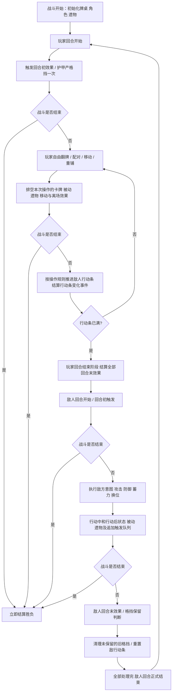

# 《记忆勇者》V7.2 · 玩家/敌人双回合与效果触发时序协议

> **2026-11-17｜用户已确认**：正式加入「玩家回合」和「敌人回合」；护甲改为**玩家回合开始时**按层数给予格挡；敌人行动条满后开始敌人回合，**该敌人回合中的所有效果结算完后才结束**。这是V7.2最新战斗时序设计（未迁移Unity）。
>
> **版本优先级**：本文件覆盖旧[01·核心战斗机制](./01-核心战斗机制.md)「隐性回合」、[25·V7.2护甲规范](./25-V7.2防御机制与卡牌详情关键词规范.md)、[28·精简投放与混搭](./28-V7.2精简投放与混搭构筑协议.md)以及[30·遗物适配](./30-V7.2遗物33件适配与混搭设计审计.md)中「敌人行动结束后护甲发盾」的触发时间。不冲突的同名配对、两实例各自结算/同快照、翻回学者、合法方向移动与蓄步无上限、96种实际卡牌候选/33件遗物候选均保持原规则。
>
> **裁决分层**：双回合边界、敌人满条进入回合、护甲玩家回合开始产盾是确认项。本稿对具体子阶段顺序、旧盾清理、每周期计数和遗物时序给出**待测试/可再改的实施建议**，不视为用户已逐条确认。

## 1. 双回合语义

| 回合 | 进入条件 | 运行内容 | 结束条件 |
|---|---|---|---|
| 玩家回合 | 战斗开场初始化完成；或上次敌人回合全部完成 | **只在回合开始时**进行一次护甲产盾及回合初效果；随后允许多次翻牌、同名配对、移动、合法重铺。每次操作才推进敌行动条（按照现有+1/+2及特殊词条） | 一次玩家操作的**全部卡牌/移动/离场/行动条效果**处理完，行动条仍已到阈值，完成玩家回合结束触发链 |
| 敌人回合 | 行动条满，且上一玩家回合完整结束 | 敌方回合开始效果→执行一次完整敌方意图（含多段/非攻击/位移）→行动后状态和遗物→敌方回合结束类效果→旧盾清理 | **所有上述效果以及收尾任务已排空**后，正式标记敌人回合结束并进入下一玩家回合 |

- 战斗开始直接进入**玩家回合1**；此时若初始护甲>0，第1回合开始即可产盾，不用等敌人先行动。
- **一次翻牌不等于一次玩家回合**；一次敌人多段攻击也不等于多个敌人回合。
- 行动条首次达阈值时只标记待切换，不能打断当前配对A/B、等待中的玩家方向选择或嵌套的有效效果。
- 若双方有一方死亡，沿用即时终局短路；**不为凑齐回合流程补触发效果**。
- 旧「每周期首次/第N次」遗物建议在V7.2按**每个玩家回合**重置，覆盖随后的一次敌人回合；只有明确写「每个敌人回合」的才独立计敌回合。此映射需游戏旧计数合同比对，不是无条件更名。
- 「回合结束」「持续N回合」需在卡牌/状态/遗物词典中**明确指玩家还是敌人回合**；易伤、虚弱等衰减规则尚需专项复核。

## 2. 主流程图

图中每个阶段必须处理完自己产生的合法嵌套效果再离开，死亡优先于普通触发；因回合初/末效果造成死亡时同样立即结算终局。

## 3. 建议采用的触发阶段事件表

| 事件代号 | 阶段 | 建议结算内容 |
|---|---|---|
| B0 `BattleStart` | 战斗开始，仅一次 | 初始化状态、牌、血量、遗物与计数器；入场预览不算真实翻开 |
| P0 `PlayerTurnStart` | 玩家回合开始一次 | 回合计数重置；回合初状态/遗物；**护甲按当前层数产格挡一次**；格挡获得监听 |
| P1 `PlayerAction` | 玩家回合内每次操作 | 真实翻开→锁蓄步；触发[翻开]；配对快照；两实例按稳定顺序生效；可能暂停选择来源+合法方向；真实翻回与学者被动 |
| P2 `ActionBarAdvance` | 一次合法玩家操作完毕 | 行动条按当前规则增长/减少，结算行动条变化监听；检测是否达到敌人阈值（只标记待切换，不插队） |
| P3 `PlayerTurnEnding` | 满条且P1/P2队列排空 | 「玩家回合结束时」事件及链式效果全部执行，最终才标记玩家回合结束 |
| E0 `EnemyTurnStart` | P3完成后 | 「敌人回合开始时」效果，可改变本次敌方行动条件；死亡短路 |
| E1 `EnemyAction` | 整个敌人回合一次意图 | 攻击/多段、防御/蓄力、位置干扰、受伤与相关触发 |
| E2 `EnemyActionResolved` | 敌人完成意图后 | 行动后遗物/被动、B02合法自动移动、**行动条满触发的中毒状态按旧时序在此只结算一次**等（此条为建议，不能双计毒伤） |
| E3 `EnemyTurnEnding` | 所有E2效果结算完 | 回合末被动，先检查R16等保留旧盾条件；继续结算末尾合法触发 |
| E4 `EnemyTurnCleanup` | 回合最终收尾 | 删除不保留的旧格挡、行动条归零；只在所有末尾效果结束后发表「敌人回合已结束」标记；本阶段**不让护甲产盾** |

**顺序保障**：若本次合法玩家操作在P2结束已达到行动条阈值，玩家回合结束事件不能再回溯/取消本次切换。若有合法行动条降低效果，应在P2的最终阈值检查前处理。敌人死亡立即胜利，不会因已达到阈值而强行执行敌人回合。

## 4. 护甲与格挡新的准确口径

- **护甲**：本场持续的防御层数；不在本次攻击中直接扣除，也不被普通攻击消耗。
- **格挡**：抵消当前伤害，旧格挡在**敌人回合末**清理（仅明确保留的旧格挡可以进入下回合）。
- **护甲产盾**：每个玩家回合开始，按照该节点读到的护甲层数**仅获得一次等量格挡**。玩家回合中途获得的护甲，不立即加盾，而是在**下次玩家回合开始**生效。
- 建议P0排序：先运行明确会改变护甲层数的「玩家回合开始」被动→冻结此时护甲值并一次性给盾→兑现其它回合初产盾及上一敌回合**已经排队**、必须在清理旧格挡后生效的遗物格挡→运行「获得格挡时」监听→解锁玩家操作。P0之后再获得护甲不补发本回合盾。
- 建议E3/E4排序：敌回合末被动→先记录旧盾保留量（R16等）→清掉非保留旧盾→敌回合正式结束；在此期间**不要再触发护甲**。

**实例**：旧格挡4、护甲3，敌人本次造成6伤害→消耗4盾、掉2血；敌人回合结束时清旧盾；**下一玩家回合开始**才由护甲重新获得3盾。若有R16保留3旧盾，则下一玩家回合实际先保留这3盾，再叠加护甲给予的3盾。若一场战斗开始时就有3护甲，则第1个玩家回合开始直接得到3格挡。

### 旧「敌人行动后产格挡」遗物迁移建议

| 遗物 | 新入口建议 | 必须防止的问题 |
|---|---|---|
| R01木盾 | 从**第2次玩家回合开始**每次+2格挡（保留其旧版「敌人首次行动后」才给盾的强度）；若希望开场也+2应单独裁决 | 无意让开局获得额外2格挡 |
| R16能量护盾 | 敌人回合末保留旧盾至多3；下一P0护甲再追加新盾 | 清盾顺序不能清掉新盾 |
| R10旧扣环 / R18思维导图 | 若敌人回合内发生合法移动，记录符合资格的获盾事件；**延后到下一P0**获得格挡；玩家回合内移动则立即获得 | 敌回合先给盾又被E4清掉 |
| R21酸蚀漏斗 | 敌人回合内由中毒实际伤害触发时，延后到下一P0发格挡 | 不能与毒层衰减或旧盾清理重复 |
| B02混沌核心 | 敌人行动后、回合结束前完成合法相邻自动交换 | 不能在敌人回合正式结束后继续产生位置事件 |
| R05笔记本 / R24旧页徽章等 | 「每周期首次」建议迁到每个**玩家回合**的限次计数中 | 不能每次手动翻开都重置计数 |

这只是时间点迁移建议，不擅改已设计好的遗物具体收益数值。旧22号V2历史实现不能直接被本稿覆盖。

## 5. 玩家可调整的关键时序点

1. **回合初护甲发盾**：在其他「回合开始时增加护甲」效果之后（本稿建议），还是之前？这会影响能否在当前回合立即兑现新护甲。
2. **敌人回合末格挡清理**：默认在敌回合末；旧盾保留遗物先判定，是否允许更多回合末触发器在清盾前额外生盾？
3. **「每周期」历史标签**：是否全部统一改写为「每个玩家回合」，还是按不同遗物在玩家/敌人回合各自计数？
4. **中毒/状态时序**：中毒沿用「行动条满后的敌人意图完成后结算一次」的旧行为建议；未来如改成敌人回合开始，应统一重做中毒/遗物触发。
5. **玩家回合结束效果**：是否允许此阶段增加/减少行动条？本稿建议保留已确定的回合切换，不允许倒退进入同一玩家回合。
6. **敌人回合中死亡短路**：敌人或玩家死亡即停止后续行动/回合触发，不能为了补齐“敌人回合结束”而额外伤害或治疗。

## 6. 验收合同与实施状态

- **核心回合**：第一玩家回合开始触发一次，连续3次翻牌若未满条都不重新触发；满条后的所有玩家效果完成才进入敌回合。
- **敌人多段/防御/蓄力**：一次完整意图只是一整个敌回合，状态/被动/遗物执行完、收尾清理后才结束。
- **护甲**：开场有2护甲→第1回合开始2盾；玩家中途得2护甲→当回合不加，下一玩家回合开始加2；每玩家回合最多一次。
- **遗物**：R16旧盾保留后，新回合再叠护甲；R10/R18/R21敌人回合触发盾不会因当回合旧盾清理被浪费；R01第1回合是否不触发需要按明确合同测试。
- **胜负与防递归**：任何阶段死亡即短路；中毒单次敌回合仅结算一次；B02自动交换后两卡各计1步。
- **当前状态**：只定义V7.2策划协议及流程图，**未修改Unity、旧遗物effectRule、运行数据、存档、测试或正式投放池**。移植时先建立双回合事件日志和先红后绿的专项测试，再重排遗物/状态事件监听。
