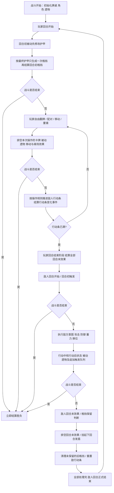

# 《记忆勇者》V7.2 · 玩家/敌人双回合与效果触发时序协议

> **后续新增裁决（2026-11-17）**：[34·消耗确认与敌方护甲对称规则](./34-V7.2消耗确认与敌方护甲对称规则.md)已确认**敌方也使用护甲**：玩家回合末清敌人旧格挡；敌人回合开始先修改敌方护甲、再按护甲产敌方格挡一次；敌人回合末仍只清玩家旧格挡。34号对本文件此前未定义的敌甲、敌盾阶段具有优先级。

> **2026-11-17｜用户已确认**：正式加入「玩家回合」和「敌人回合」；护甲改为**玩家回合开始时**按层数给予格挡；敌人行动条满后开始敌人回合，**该敌人回合中的所有效果结算完后才结束**。这是V7.2最新战斗时序设计（未迁移Unity）。
>
> **版本优先级**：本文件覆盖旧[01·核心战斗机制](./01-核心战斗机制.md)「隐性回合」、[25·V7.2护甲规范](./25-V7.2防御机制与卡牌详情关键词规范.md)、[28·精简投放与混搭](./28-V7.2精简投放与混搭构筑协议.md)以及[30·遗物适配](./30-V7.2遗物33件适配与混搭设计审计.md)中「敌人行动结束后护甲发盾」的触发时间。不冲突的同名配对、两实例各自结算/同快照、翻回学者、合法方向移动与蓄步无上限、96种实际卡牌候选/33件遗物候选均保持原规则。
>
> **裁决更新（2026-11-17，用户同意按建议执行）**：双回合边界以及以下三项时序正式作为**V7.2策划规则**：①玩家回合开始先结算回合初护甲变化，再仅一次按当前护甲产盾；②敌人回合末先排空回合末效果，再判定旧盾保留与清理，敌人回合触发但应供下一玩家回合使用的格挡先挂起、下次玩家回合初兑现；③旧「每周期」按事件归属明确为玩家回合、敌人回合，或跨玩家回合及紧接敌人回合的窗口，中毒仅结算一次。具体遗物数值仍是待测候选，尚未迁移Unity。

## 1. 双回合语义

| 回合 | 进入条件 | 运行内容 | 结束条件 |
|---|---|---|---|
| 玩家回合 | 战斗开场初始化完成；或上次敌人回合全部完成 | **只在回合开始时**进行一次护甲产盾及回合初效果；随后允许多次翻牌、同名配对、移动、合法重铺。每次操作才推进敌行动条（按照现有+1/+2及特殊词条） | 一次玩家操作的**全部卡牌/移动/离场/行动条效果**处理完，行动条仍已到阈值，完成玩家回合结束触发链 |
| 敌人回合 | 行动条满，且上一玩家回合完整结束 | 敌方回合开始效果→执行一次完整敌方意图（含多段/非攻击/位移）→行动后状态和遗物→敌方回合结束类效果→旧盾清理 | **所有上述效果以及收尾任务已排空**后，正式标记敌人回合结束并进入下一玩家回合 |

- 战斗开始直接进入**玩家回合1**；此时若初始护甲>0，第1回合开始即可产盾，不用等敌人先行动。
- **一次翻牌不等于一次玩家回合**；一次敌人多段攻击也不等于多个敌人回合。
- 行动条首次达阈值时只标记待切换，不能打断当前配对A/B、等待中的玩家方向选择或嵌套的有效效果。
- 若双方有一方死亡，沿用即时终局短路；**不为凑齐回合流程补触发效果**。
- **旧「每周期」正式拆分为三类**：仅玩家操作的监听器，计数器在`PlayerTurnStart`清零、只在该玩家回合内触发；仅敌人行动的监听器，在`EnemyTurnStart`清零、只在该敌人回合触发；横跨玩家操作及其导致的**紧接一次敌人回合**的监听器，在该次`PlayerTurnStart`清零、直到相应`EnemyTurnCleanup`结束都有效。具体每件遗物的归属见[30·V7.2遗物适配](./30-V7.2遗物33件适配与混搭设计审计.md)。**不能将旧「每周期」无差别全改成玩家回合**。
- 「回合结束」「持续N回合」需在卡牌/状态/遗物词典中**明确指玩家还是敌人回合**；易伤、虚弱等衰减规则尚需专项复核。

## 2. 主流程图

图中每个阶段必须处理完自己产生的合法嵌套效果再离开，死亡优先于普通触发；因回合初/末效果造成死亡时同样立即结算终局。

## 3. 建议采用的触发阶段事件表

| 事件代号 | 阶段 | 建议结算内容 |
|---|---|---|
| B0 `BattleStart` | 战斗开始，仅一次 | 初始化状态、牌、血量、遗物与计数器；入场预览不算真实翻开 |
| P0 `PlayerTurnStart` | 玩家回合开始一次 | 依稳定优先级重置新回合计数→**结算所有明确「玩家回合开始时调整护甲」的效果，排空其队列**→冻结护甲层数并且**仅一次**获得等量格挡→兑现上个敌人回合已挂起的格挡和本回合初其它格挡→统一触发获得格挡监听，排空后开放玩家操作 |
| P1 `PlayerAction` | 玩家回合内每次操作 | 真实翻开→锁蓄步；触发[翻开]；配对快照；两实例按稳定顺序生效；可能暂停选择来源+合法方向；真实翻回与学者被动 |
| P2 `ActionBarAdvance` | 一次合法玩家操作完毕 | 行动条按当前规则增长/减少，结算行动条变化监听；检测是否达到敌人阈值（只标记待切换，不插队） |
| P3 `PlayerTurnEnding` | 满条且P1/P2队列排空 | 「玩家回合结束时」事件及链式效果全部执行，最终才标记玩家回合结束 |
| E0 `EnemyTurnStart` | P3完成后 | 「敌人回合开始时」效果，可改变本次敌方行动条件；死亡短路 |
| E1 `EnemyAction` | 整个敌人回合一次意图 | 攻击/多段、防御/蓄力、位置干扰、受伤与相关触发 |
| E2 `EnemyActionResolved` | 敌人完成意图后 | 行动后遗物/被动、B02合法自动移动、**行动条满触发的中毒状态按旧时序在此只结算一次**等（此条为建议，不能双计毒伤） |
| E3 `EnemyTurnEnding` | 所有E2效果结算完 | **先执行并排空敌人回合结束的效果链**；本阶段产生的即时盾属于本敌人回合旧盾，指定「下次玩家回合给盾」的收益仅记录待发放凭据，不在这里添加格挡；随后R16等锁定旧盾保留量 |
| E4 `EnemyTurnCleanup` | 回合最终收尾 | 删除不保留的旧格挡、重置行动条、结束跨回合监听窗口；**全部队列排空**后正式发布「敌人回合结束」，紧接下一P0才兑现延后格挡且执行护甲产盾；本阶段不让护甲产盾 |

**顺序保障**：若本次合法玩家操作在P2结束已达到行动条阈值，玩家回合结束事件不能再回溯/取消本次切换。若有合法行动条降低效果，应在P2的最终阈值检查前处理。敌人死亡立即胜利，不会因已达到阈值而强行执行敌人回合。

## 4. 护甲与格挡新的准确口径

- **护甲**：本场持续的防御层数；不在本次攻击中直接扣除，也不被普通攻击消耗。
- **格挡**：抵消当前伤害，旧格挡在**敌人回合末**清理（仅明确保留的旧格挡可以进入下回合）。
- **护甲产盾**：每个玩家回合开始，按照该节点读到的护甲层数**仅获得一次等量格挡**。玩家回合中途获得的护甲，不立即加盾，而是在**下次玩家回合开始**生效。
- **P0确定排序**：先运行并排空明确会改变护甲层数的「玩家回合开始」被动→冻结此时护甲值并**仅一次获得相应格挡**→兑现其它回合初奖励和上一敌人回合排队的格挡→统一结算「获得格挡时」监听→解锁玩家操作。护甲产盾时触发的监听即使再增加护甲，也不得在同一玩家回合重新产盾；玩家回合中途新增护甲只能在下一P0产盾。
- **E3/E4确定排序**：敌人行动后触发→敌人回合结束的效果**全部执行完毕**→把明确属于「下次玩家回合获得格挡」的奖励保存为待兑现事件（不会提前增加当前格挡）→R16等记录旧盾保留值→清掉未保留的旧盾→处理终局与必要收尾并正式结束敌人回合；这个阶段**绝不触发护甲产盾**。敌人回合末普通「立即获得格挡」若不明示跨回合，则视为旧盾参与清理，而不是自动延期。

**实例**：旧格挡4、护甲3，敌人本次造成6伤害→消耗4盾、掉2血；敌人回合结束时清旧盾；**下一玩家回合开始**才由护甲重新获得3盾。若有R16保留3旧盾，则下一玩家回合实际先保留这3盾，再叠加护甲给予的3盾。若一场战斗开始时就有3护甲，则第1个玩家回合开始直接得到3格挡。

### 旧「敌人行动后产格挡」遗物迁移建议

| 遗物 | 新入口建议 | 必须防止的问题 |
|---|---|---|
| R01木盾 | 从**第2次玩家回合开始**每次+2格挡（保留其旧版「敌人首次行动后」才给盾的强度）；若希望开场也+2应单独裁决 | 无意让开局获得额外2格挡 |
| R16能量护盾 | 敌人回合末保留旧盾至多3；下一P0护甲再追加新盾 | 清盾顺序不能清掉新盾 |
| R10旧扣环 / R18思维导图 | 若敌人回合内发生合法移动，记录符合资格的获盾事件；**延后到下一P0**获得格挡；玩家回合内移动则立即获得 | 敌回合先给盾又被E4清掉 |
| R21酸蚀漏斗 | 敌人回合内由中毒实际伤害触发时，延后到下一P0发格挡 | 不能与毒层衰减或旧盾清理重复 |
| B02混沌核心 | 敌人行动后、回合结束前完成合法相邻自动交换 | 不能在敌人回合正式结束后继续产生位置事件 |
| R05笔记本 / R24旧页徽章等 | 「每周期首次」建议迁到每个**玩家回合**的限次计数中 | 不能每次手动翻开都重置计数 |

上述时点迁移规则已按用户决定列为V7.2策划合同，**不擅自改变遗物的数值**；具体改写的新遗物文案以30号V7.2草案为准。旧22号V2历史实现不能直接被本稿覆盖。

## 5. 已确认裁决与仍待明确的边界

**本轮已确认**：

1. `PlayerTurnStart`先运行护甲变化，再按最终护甲值产盾一次；之后其它回合初格挡和延后奖励叠加。
2. `EnemyTurnEnding`先完成全部末尾效果，后锁定旧盾保留、清理不保留旧盾，再发表敌人回合结束；敌人回合触发的「供下一玩家回合使用」的盾在下一P0发放。
3. 旧`每周期`按具体触发来源分别绑定玩家回合、敌人回合或二者连贯的窗口；不再允许新文案使用不加限定的「本回合/每周期」。
4. 中毒保留旧的「实际行动条满引发的一次结算」语义，当前迁移绑定`EnemyActionResolved`，**每次敌人回合最多结算一次**，不得在行动条满瞬间、EnemyTurnStart、EnemyTurnEnd分别再伤害。

**还需实施验收、未改变既有玩法的边界**：

- `R01木盾`：从第二次玩家回合开始发+2，以保持原先敌人出手后才给盾的强度，开场不附赠。
- `R28沿迹罗盘`：敌方回合移动牌发生后，记录该事件；**下一玩家回合**首次真正手动翻开被移动实例时才兑现格挡，记录在该玩家回合结束时失效，不可沿用「敌人移动与玩家翻开在同一回合」这个不可能的条件。
- 玩家回合结束触发导致行动条变化：不得倒退已经确定的敌人回合切换；回合末伤害可在敌人回合开始前直接终局。
- 易伤/虚弱等「持续N回合」旧状态，应逐项明确其玩家/敌人回合归属与衰减事件；本轮不擅自改动层数、持续时间或敌方护甲含义。

## 6. 验收合同与实施状态

- **核心回合**：第一玩家回合开始触发一次，连续3次翻牌若未满条都不重新触发；满条后的所有玩家效果完成才进入敌回合。
- **敌人多段/防御/蓄力**：一次完整意图只是一整个敌回合，状态/被动/遗物执行完、收尾清理后才结束。
- **护甲**：开场有2护甲→第1回合开始2盾；玩家中途得2护甲→当回合不加，下一玩家回合开始加2；每玩家回合最多一次。
- **遗物**：R16旧盾保留后，新回合再叠护甲；R10/R18/R21敌人回合触发盾挂起到下一P0；R01首回合不触发、次回合起+2；R28敌人回合记录的目标必须在下一玩家回合可被手动翻开才获盾。
- **胜负与防递归**：任何阶段死亡即短路；中毒单次敌回合仅结算一次；B02自动交换后两卡各计1步。
- **当前状态**：只定义V7.2策划协议及流程图，**未修改Unity、旧遗物effectRule、运行数据、存档、测试或正式投放池**。移植时先建立双回合事件日志和先红后绿的专项测试，再重排遗物/状态事件监听。
